# EGM fundamentals and Codex integration

## EGM in this study

EGM stands for **Elephant–Goldfish Model**. The upstream project describes it as a spec-driven development workflow: one assistant develops an idea with the project context, then fresh reviewers assess the written plan without the earlier conversation. The human checks the findings, makes trade-offs, and approves what is built. EGM is a workflow and plugin, not a claim that an AI-generated design is correct.

The upstream README says the project is not an officially supported Google product; this repository describes the plugin workflow used, not a Google endorsement.

The metaphor describes context roles:

| Role | Context | Work in this experiment |
|---|---|---|
| Elephant | The accumulated idea, project facts, constraints, and decisions | Asked clarifying questions, synthesized `concepts_brief.md`, drafted `design_draft.md`, and coordinated implementation |
| Goldfish | The target document plus explicitly supplied supporting context, without the earlier brainstorming conversation | Challenged assumptions, omissions, consistency, simplicity, and implementation readiness |
| Human | Product intent, constraints, and approval authority | Clarified behavior, selected trade-offs, approved document sections, chose review dispositions, and authorized implementation |

The term “fresh context” refers to conversation history. It does not mean reviewers are isolated from every host instruction, shared filesystem, or other environment state. The consolidated report explicitly records that the host could not prove project instruction files were excluded.

## Why fresh-context review may help

A reviewer that did not see the persuasive or incomplete path used to create a design can read the resulting artifact as a new implementer might. It may notice missing rules, ambiguous state transitions, hidden edge cases, or promises that the architecture cannot make. In this experiment, a reviewer found that the Node-based cross-tab tests lacked a specified event target. Other reviewers highlighted unclear save-state transitions, the meaning of Active, and overbroad cross-tab claims.

That benefit is conditional. A fresh reviewer can misunderstand the artifact, raise a false positive, or miss a problem. The review must include enough supporting material to evaluate the design. Findings still need human adjudication and implementation tests.

## Workflow-level mechanics

The installed EGM plugin supplies separate skills and reviewer/persona instructions. It does not run one indivisible pipeline; skills can be used as needed. The core software-design flow used here was:

```mermaid
flowchart LR
  H[Human clarifies idea] --> B[Brainstorm skill]
  B --> C[concepts_brief.md]
  C --> D[Draft skill, section approvals]
  D --> S[design_draft.md]
  S --> R[Five-stage fresh-context review]
  R --> F[Review reports]
  F --> A[Human accepts, rejects, or defers findings]
  A --> I[Approved implementation]
  I --> V[Tests and build]
```



In the brainstorm phase, the assistant asks open questions, presents an anchored hypothesis, and waits for approval before its multi-lens review. In drafting, it writes one section at a time and pauses for human feedback. The review skill runs five stages: overall approach, comprehension, design critique, another high-level pass after changes, and implementation readiness. Resolution keeps the reviewer’s recommendation separate from the human’s decision.

## Codex CLI integration

EGM is packaged as a Codex plugin with skills, reviewer personas, and document standards. The upstream Codex integration guide currently documents these CLI setup commands:

```sh
codex plugin marketplace add google/elephant-goldfish-model
codex plugin add egm@egm
```

The guide says to start a fresh Codex session after installation and select the installed EGM skill. Goldfish review also requires the harness to provide fresh-context subagents; a normal same-context critique is not equivalent.

**What the experiment record establishes:** EGM skill entries were available and invoked in the Codex workflow (for example, the user invoked the brainstorm skill and later explicitly selected the installed draft/review workflows). The review report records nine fresh-context reviewer executions across the five stages and notes host isolation limits.

**What the record does not establish:** It does not preserve the actual plugin-install command, the Codex CLI version, a plugin version, or repository-level EGM configuration. The official commands above are reproducible guidance from the installed plugin documentation, not a claim that those exact commands were used in this experiment. There is no EGM configuration file in this application repository.

## References

- [EGM upstream repository and README](https://github.com/google/elephant-goldfish-model)
- [EGM Codex integration guide](https://github.com/google/elephant-goldfish-model/blob/main/docs/codex.md)
- [EGM workflow guide](https://github.com/google/elephant-goldfish-model/blob/main/docs/getting_started.md)
- [Dave Rensin’s article named by the upstream project](https://medium.com/@drensin/elephants-goldfish-and-the-new-golden-age-of-software-engineering-c33641a48874)
- [Experiment concept brief](concepts_brief.md)
- [Consolidated review and reviewer-execution caveats](reviews/consolidated_review_report.md)
